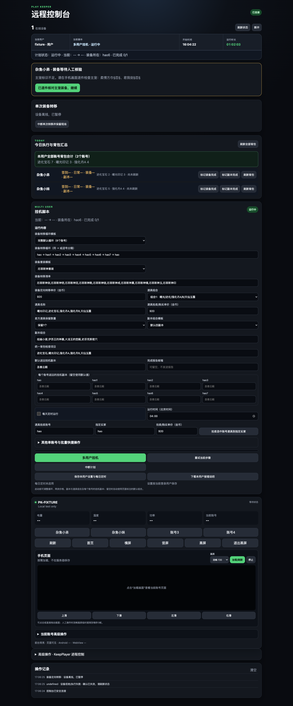
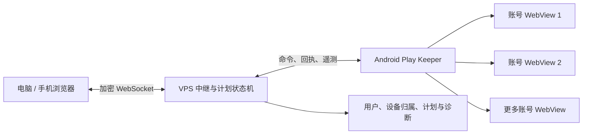

# Play Keeper

Play Keeper 是面向 Android 10 及以上设备的多账号网页挂机与远程自动化工具。它把多个相互隔离的游戏账号、Android 执行端、VPS 调度服务和浏览器控制台组合在一起，用于完成日常任务、副本、仓库整理、装备接力和道具拍卖等重复流程。

当前正式版：**v2.0.4** · [下载 APK 与 VPS 包](https://github.com/little-hao/Play_keeper/releases/latest) · [更新记录](CHANGELOG.md)

> 本项目操作真实游戏账号与物品。首次使用请先用低价值道具、小范围账号路线验证设置；涉及交易时应核对卖方、买方、名称和价格。

## 界面预览

控制台会集中显示登录用户、当前脚本、开始时间、实时运行时长、在线设备、账号状态和待人工处理事项。页面针对电脑、平板与手机浏览器做了响应式适配。

<picture>
  <source media="(max-width: 640px)" srcset="docs/assets/remote-console-mobile.png">
  
</picture>

> 截图使用脱敏演示数据生成，不包含真实账号密码、设备令牌或 Cookie。

## 主要能力

- **多账号隔离**：每个 WebView 保存独立登录状态，可在同一设备管理多个游戏账号。
- **跨设备接力**：卖方和买方可位于同一设备或不同设备，VPS 根据账号名称协调装备交接。
- **多用户与设备归属**：管理员管理全部设备，普通用户只查看和控制已分配设备。
- **远程控制**：查看低帧率设备画面，执行点击、滑动、账号切换、横竖屏、黑屏和 KeepPlayer 进程操作。
- **断点恢复**：短暂掉线会保留当前交接段；异常时记录装备所在账号、错误信息和现场，人工确认后继续。
- **可验证发布**：正式 APK 保持固定包名与签名，Release 同时提供 APK、VPS 包和 SHA-256 文件。

## 自动化脚本说明

### 1. 多用户挂机计划

这是完整的跨账号编排入口。用户可以配置闭环路线，例如 `hao → hao1 → hao2 → hao`，以及装备套装、交易价格、道具组合、副本组合和每个账号结束后的挂机地图。

每一棒通常按以下顺序运行：

1. 当前卖方分批上架目标装备；
2. 下一账号购买并核对装备；
3. 买方接受日常任务、整理背包并执行副本；
4. 买方成为下一棒卖方，上一卖方穿回剩余装备并返回挂机；
5. 小号完成后拍卖指定道具，最终主号按配置价格购买并回到自己的挂机地图。

计划会参考今日副本状态跳过已完成账号，但保留装备持有者和最终主号。遇到离线、装备位置不明或高风险页面异常时，会暂停并等待人工确认，而不是盲目重复交易。

### 2. 装备定向转移

将指定套装从卖方转移给指定买方。脚本支持自定义装备名称、单价和买家账号，每批最多处理五件，并在成交后继续下一批。

- 卖方：核对主宠、执行脱装、精确选择装备、填写价格和买家、等待成交；
- 买方：必要时先卖出金币券，进入装备交易所购买并核对目标套装；
- 收尾：买方穿戴目标装备，卖方穿回剩余装备，双方回到各自配置的挂机地图。

如果设备掉线或交易只完成一部分，恢复流程会区分“仍在背包、已经上架、已经成交”的装备，避免从第一件重复操作。

### 3. 道具拍卖

卖方在道具交易所上架指定组合，可设置买家、单价以及每种道具保留数量。支持单账号快捷拍卖，也支持路线内的小号依次拍卖。

### 4. 道具购买

指定买家按当前保存的价格搜索并购买目标道具。价格不是固定值；主号购买失败或等待超时时会安全结束购买，并继续返回其配置的挂机地图。

### 5. 金币券商店卖出

在主游戏的“中心城镇 → 道具商店”卖出配置的金币券，为装备购买准备金币。入口暂时无法识别时会有限重试或跳过，不会让整条装备接力永久卡死。

### 6. 一键接受日常任务

打开挂机辅助的任务列表，切换到日常任务并执行一键接受。脚本会等待页面加载、处理网站确认弹窗并复核结果；识别失败时记录提示后继续副本流程。

### 7. 副本组合

按用户配置顺序运行多个副本。开始前可以执行签到、日常任务、存仓等准备动作；单个副本已完成或未解锁时会记录并继续下一项。

副本结束后脚本会一键穿戴剩余装备、刷新背包状态，并回到该账号配置的挂机地图。

### 8. 背包存仓

打开挂机辅助的仓库/背包弹窗，将配置道具或全选背包内容存入仓库。可手动立即执行，也可用于挂机或副本前整理。仓库已满或页面无进展时有重试上限，避免无限循环。

### 9. 威望道具使用

在圣殿挂机场景检查并批量使用配置的威望道具。该脚本与副本准备分离，避免在不合适的页面误用道具。

### 10. 背包快照与今日汇总

读取各账号指定物品数量，在远程控制台显示账号明细和同类物品合计。用户可以单独刷新账号或刷新全部背包，也可以人工标记装备/副本完成状态。

### 11. 返回挂机与挂机守护

检查账号是否位于目标地图并处于挂机状态；必要时重新进入挂机辅助、选择宠物和技能并启动挂机。目标地图既可统一设置，也可按账号分别配置。

### 12. 卖方收尾

装备确认到达买方后，原卖方在后台穿回剩余装备并返回挂机。该步骤与下一账号的副本及后续接力解耦：收尾失败会保留警告，但不会把已经完成的装备交接倒退。

### 13. 中断、人工确认与继续

APP 和远程控制台均可中断脚本。异常现场会保留错误信息与截图；用户确认套装实际所在账号后，系统按原完整路线和当前阶段继续，而不是每次从主号重新开始。

## 系统组成



- **Android APP**：保存账号会话、识别网页状态并执行脚本，上传设备遥测与脱敏预览。
- **VPS 服务**：认证用户与设备、协调跨设备步骤、持久化计划、处理断线恢复并生成报告。
- **远程控制台**：提供响应式操作界面，显示当前事实、运行进度、背包汇总和人工恢复入口。

## 安装与升级

### Android

1. 从 [Latest Release](https://github.com/little-hao/Play_keeper/releases/latest) 下载 `PlayKeeper-Android10Plus-*.apk`。
2. Android 10 或更高版本允许安装该 APK。
3. 正式版包名为 `com.local.sgplaykeeper.test.v190`；同一签名的新正式版可覆盖升级并保留应用数据。
4. Candidate 与 Mac Parallel 使用独立包名，只用于并行测试，不能覆盖正式版。

### VPS

VPS 包位于同一 Release。部署前必须备份并在升级后恢复生产数据：

- `.env`；
- `remote-server/data/users.json`；
- 计划、定时与单次转移状态文件；
- 邮件配置、诊断记录和现场截图。

发布包不会携带生产凭据或签名密钥。完整步骤见 [发布指南](docs/RELEASE_GUIDE.md) 和对应版本的 Release Notes。

## 本地开发

环境基线：Java 17、Android SDK 35、Build Tools 35.0.0、Gradle 8.9、Android Gradle Plugin 8.7.3、Node.js 20+。

```bash
# Android 单元测试与正式构建
./gradlew --no-daemon clean test assembleRelease

# VPS 安装依赖并运行测试
cd remote-server
npm ci
npm test
```

正式构建使用 `assembleRelease`。签名文件应放在 `signing/debug.keystore`，但必须通过加密渠道单独保存，不能提交到公开仓库或附加到 Release。

## 安全与隐私

- 不要把控制台密码、`device_token`、Cookie、`.env` 或 keystore 写入 Issue、截图、日志或 Git。
- 普通用户只能访问管理员分配的设备；设备归属校验同时用于命令、预览和状态数据。
- 远程画面用于人工核对，发布文档应使用脱敏截图。
- 交易自动化必须以页面实际观察结果为准；证据不足时应暂停人工确认。

## 文档索引

- [CHANGELOG](CHANGELOG.md)
- [v2.0.4 发布说明](docs/V2.0.4_RELEASE_NOTES.md)
- [v2.0.4 制品与校验值](docs/V2.0.4_BUILD_MANIFEST.md)
- [开发环境](docs/DEVELOPMENT.md)
- [多用户诊断说明](docs/MULTI_USER_DIAGNOSTICS.md)
- [发布指南](docs/RELEASE_GUIDE.md)
- [旧版首页完整记录](docs/archive/README_BEFORE_V2.0.4_PRODUCT_OVERVIEW.md)

## 许可与使用范围

本仓库当前未声明开源许可证。除非仓库所有者另行授权，源代码与发布制品仅按仓库所有者允许的范围使用。
